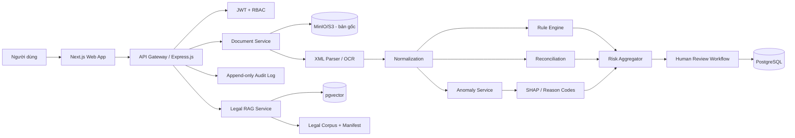

# AICount Guard

> Hệ thống AI hỗ trợ kiểm tra hóa đơn, phát hiện sai lệch nghiệp vụ kế toán và quản trị rủi ro theo hướng **AI hỗ trợ – con người phê duyệt**.

[](#trạng-thái)
[](legal/manifest.json)
[](#nguyên-tắc-bắt-buộc)

## 1. Mục tiêu

AICount Guard tiếp nhận hóa đơn XML/PDF/ảnh, trích xuất và chuẩn hóa dữ liệu, kiểm tra bằng quy tắc pháp lý/nghiệp vụ, đối chiếu chứng từ liên quan, phát hiện bất thường bằng Machine Learning và cung cấp bằng chứng giải thích cho từng cảnh báo.

Hệ thống **không tự động ghi sổ, kê khai thuế hoặc kết luận vi phạm pháp luật**. Kế toán viên/kế toán trưởng vẫn là người xác nhận dữ liệu và quyết định cuối cùng.

## 2. Phạm vi MVP

MVP ưu tiên một luồng end-to-end:

1. Đăng nhập và phân quyền theo vai trò.
2. Tải hóa đơn XML, PDF hoặc ảnh.
3. Lưu bản gốc, checksum và phiên xử lý.
4. Trích xuất trường hóa đơn và độ tin cậy.
5. Chạy bộ quy tắc hóa đơn, số học và thuế.
6. Kiểm tra trùng lặp và đối chiếu PO/phiếu nhập/thanh toán.
7. Tính điểm bất thường và điểm rủi ro tổng hợp.
8. Hiển thị reason codes, bằng chứng và nguồn pháp lý.
9. Người dùng chấp nhận, từ chối hoặc chuyển cấp.
10. Ghi audit log cho toàn bộ thay đổi và quyết định.

Không nằm trong MVP: tự động ghi sổ, tự động kê khai, tự động thay đổi bút toán, tư vấn pháp lý cuối cùng hoặc dùng LLM để quyết định thuế suất.

## 3. Nguyên tắc bắt buộc

- **Rule before LLM:** quy tắc xác định và dữ liệu nguồn có quyền ưu tiên cao hơn nội dung sinh bởi LLM.
- **Human-in-the-loop:** cảnh báo rủi ro cao, sửa dữ liệu, đề xuất tài khoản và bỏ qua cảnh báo đều cần người có quyền xác nhận.
- **Evidence-first:** mỗi kết luận phải trỏ tới trường dữ liệu, chứng từ đối chiếu, phiên bản quy tắc/mô hình và nguồn pháp lý.
- **No legal hallucination:** không tạo số hiệu, điều, khoản, ngày hiệu lực hoặc mức phạt khi không có trong corpus đã duyệt.
- **Version everything:** phiên bản dữ liệu, quy tắc, embedding, model, prompt và tài liệu pháp lý đều phải truy vết được.
- **No raw production data for training:** dữ liệu thật chỉ được dùng khi có căn cứ phù hợp, được tối thiểu hóa/ẩn danh và phê duyệt truy cập.
- **RAG thay vì fine-tune luật:** văn bản pháp luật thay đổi theo thời gian; kiến thức pháp lý nên được truy xuất theo hiệu lực thay vì “đóng cứng” trong trọng số mô hình.

## 4. Kiến trúc đề xuất



### Stack mặc định

| Lớp            | Công nghệ                                                       |
| -------------- | --------------------------------------------------------------- |
| Frontend       | Next.js + TypeScript + Tailwind CSS                             |
| Backend        | TypeScript strict + Express.js 5 + Node.js 22                   |
| Database       | PostgreSQL 16 + pgvector                                        |
| Object storage | MinIO/S3                                                        |
| Cache/queue    | Redis; bổ sung RabbitMQ khi cần xử lý nền lớn                   |
| OCR/XML        | XML parser; PaddleOCR/DocTR/LayoutLM theo benchmark             |
| ML             | scikit-learn, XGBoost, SHAP                                     |
| RAG            | sentence-transformers hoặc embedding API có kiểm soát; pgvector |
| Auth           | JWT/OAuth2, RBAC                                                |
| Deploy         | Docker Compose trước; Kubernetes sau khi có nhu cầu             |

## 5. Cấu trúc repository mục tiêu

```text
.
├── apps/
│   ├── web/                     # Next.js
│   ├── api/                     # Express.js gateway/business API
│   └── mobile/                  # Expo React Native (Android/iOS)
├── services/
│   ├── document-service/        # upload, checksum, XML/OCR
│   ├── rule-engine/             # rule-as-data
│   ├── reconciliation-service/  # PO/GRN/payment/ledger matching
│   ├── anomaly-service/         # model inference + SHAP
│   └── legal-rag-service/       # ingest/search/citation
├── packages/
│   ├── contracts/               # OpenAPI/JSON Schema/shared types
│   └── ui/                      # shared components
├── config/rules/                # YAML/JSON rules versioned
├── legal/
│   ├── raw/                     # PDF gốc từ nguồn chính thức
│   ├── processed/               # text/chunks sinh tự động, không sửa tay
│   ├── manifest.json            # metadata + hiệu lực + checksum
│   └── manifest.csv
├── scripts/
│   ├── verify_legal_corpus.py
│   ├── extract_legal_corpus.py
│   └── chunk_legal_corpus.py
├── tests/
│   ├── unit/
│   ├── integration/
│   ├── legal-regression/
│   └── security/
├── docker-compose.dev.yml
├── .env.example
└── README.md
```

## 6. Khởi động hạ tầng phát triển

```bash
cp .env.example .env
docker compose -f docker-compose.dev.yml up -d
```

Dịch vụ mặc định:

- PostgreSQL/pgvector: `localhost:5432`
- Redis: `localhost:6379`
- MinIO API: `localhost:9000`
- MinIO Console: `localhost:9001`
- Next.js workspace: `http://localhost:3000`
- Express API: `http://localhost:8000/api/v1`
- OpenAPI UI: `http://localhost:8000/docs`

Web và mobile dùng cùng ngôn ngữ thiết kế trung tính, đường viền mảnh và bố cục
workspace nhiều lớp. Cả hai hỗ trợ `System`, `Light`, `Dark`, lưu lựa chọn trên thiết bị
và không thay đổi nguyên tắc human-in-the-loop. Web có giao diện responsive cho desktop/
điện thoại; mobile cung cấp tổng quan, hóa đơn, bằng chứng, phê duyệt, tra cứu pháp lý và
cài đặt tài khoản bằng Expo React Native.

Web có Command Center kiểu editor: nhấn `Ctrl+K`/`Cmd+K` để tìm hóa đơn, văn bản pháp lý
hoặc điều hướng; nhấn `Ctrl+Shift+P`/`Cmd+Shift+P` (hoặc gõ `>`) để chỉ chạy lệnh. Trang
pháp lý hiển thị đủ danh mục PDF trong Explorer và tải preview qua API có xác thực; backend
đối chiếu kích thước và SHA-256 với manifest trước khi trả nội dung.

Kiểm tra riêng backend TypeScript trước khi tạo image:

```bash
npm ci
npm run typecheck:backend
npm run test:backend
npm run build:backend
npm run test:ui # cần stack Docker đang chạy và Edge/Chrome cục bộ

cd apps/web && npm run build
cd ../mobile && npm run typecheck && npm run export:android
```

Không commit file `.env`, token, mật khẩu, hóa đơn thật hoặc dữ liệu khách hàng.

## 7. Mô hình dữ liệu tối thiểu

Các bảng chính:

- `users`, `roles`, `user_roles`
- `invoices`, `invoice_files`, `invoice_lines`
- `extraction_runs`, `extracted_fields`, `field_corrections`
- `rule_versions`, `rule_results`
- `reconciliation_runs`, `reconciliation_items`
- `model_versions`, `model_predictions`, `prediction_explanations`
- `risk_assessments`
- `review_tasks`, `review_decisions`
- `audit_events`
- `legal_documents`, `legal_chunks`, `legal_citations`
- `incidents`, `model_monitoring_metrics`

Mọi bảng kết quả phải có tối thiểu: `created_at`, `created_by`, `source_version`, `correlation_id` và trạng thái bất biến/phiên bản khi phù hợp.

## 8. API MVP

```text
POST   /api/v1/invoices
GET    /api/v1/invoices/{invoice_id}
POST   /api/v1/invoices/{invoice_id}/extract
POST   /api/v1/invoices/{invoice_id}/validate
POST   /api/v1/invoices/{invoice_id}/reconcile
POST   /api/v1/invoices/{invoice_id}/score
GET    /api/v1/invoices/{invoice_id}/evidence
POST   /api/v1/reviews/{review_id}/decisions
GET    /api/v1/legal/search?q=...
GET    /api/v1/legal/documents
GET    /api/v1/legal/documents/{document_id}
GET    /api/v1/legal/documents/{document_id}/pdf
GET    /api/v1/legal/corpus/status
GET    /api/v1/audit/events
```

Mỗi response cảnh báo nên có dạng:

```json
{
  "code": "ARITHMETIC_MISMATCH",
  "severity": "high",
  "message": "Tổng thanh toán không khớp tiền trước thuế và tiền thuế.",
  "observed": 11050000,
  "expected": 11000000,
  "evidence": [
    { "field": "total_amount", "source": "invoice.xml" },
    { "field": "subtotal", "source": "invoice.xml" },
    { "field": "tax_amount", "source": "invoice.xml" }
  ],
  "rule_version": "invoice-arithmetic@1.0.0",
  "legal_citations": [
    {
      "document_id": "VN-INV-123-2020-NDCP",
      "locator": "Điều/khoản được chuyên gia xác nhận trong bước legal review"
    }
  ],
  "requires_human_review": true
}
```

Không phát hành rule có `locator` chưa được xác nhận sang môi trường production.

## 9. Điểm rủi ro prototype

```text
RiskScore =
  0.35 × RuleScore
+ 0.30 × AnomalyScore
+ 0.20 × ReconciliationScore
+ 0.10 × DataQualityScore
+ 0.05 × UncertaintyScore
```

Ngưỡng demo:

- `< 30`: thấp
- `30–<60`: trung bình
- `>= 60`: cao

Trọng số và ngưỡng chỉ là cấu hình ban đầu; phải hiệu chỉnh trên tập test khóa và được người có thẩm quyền phê duyệt trước khi áp dụng thực tế.

## 10. Legal corpus

Thư mục `legal/raw` đã chứa 31 PDF lấy từ các cổng văn bản chính thức của Nhà nước, chốt tại ngày **2026-07-20**. Metadata, checksum SHA-256, ngày hiệu lực và vai trò của từng văn bản nằm trong:

- `legal/manifest.json`
- `legal/manifest.csv`

Image backend production chứa chính 31 PDF này để chức năng preview hoạt động mà không
phụ thuộc bind mount. Endpoint PDF là endpoint có xác thực, chỉ phục vụ tệp nằm trong
`legal/raw` và từ chối khi checksum hoặc kích thước không còn khớp manifest.

Nhóm văn bản chính:

| Nhóm              | Văn bản trọng tâm                                                                                                    | Dùng cho                                                               |
| ----------------- | -------------------------------------------------------------------------------------------------------------------- | ---------------------------------------------------------------------- |
| AI                | Luật 134/2025/QH15; NĐ 142/2026/NĐ-CP; QĐ 33/2026/QĐ-TTg                                                             | Risk governance, transparency, human oversight, model/incident records |
| Hóa đơn           | NĐ 123/2020/NĐ-CP; NĐ 70/2025/NĐ-CP; TT 32/2025/TT-BTC                                                               | Trường bắt buộc, thời điểm lập, xử lý/sửa đổi, rule engine             |
| Kế toán/thuế      | Luật Kế toán 88/2015; Luật 56/2024; TT 99/2025; Luật Quản lý thuế 38/2019; NĐ 373/2025                               | Chứng từ, tài khoản, sổ, kiểm soát nội bộ và quản lý thuế              |
| Thuế TNDN         | Luật 67/2025; NĐ 320/2025; NĐ 141/2026; TT 20/2026                                                                   | Điều kiện chi phí được trừ, chứng từ thanh toán và ngoại lệ            |
| Thuế GTGT         | Luật 48/2024; Luật 90/2025; NĐ 181/2025; NĐ 359/2025; NĐ 144/2026; TT 69/2025                                        | Thuế suất, giá tính thuế, điều kiện và ngoại lệ                        |
| Dữ liệu điện tử   | Luật Giao dịch điện tử 20/2023; NĐ 23/2025; Luật Dữ liệu 60/2024; NĐ 165/2025; Luật Bảo vệ DLCN 91/2025; NĐ 356/2025 | Tính toàn vẹn, chữ ký, quản trị, lưu trữ, chứng cứ và quyền riêng tư   |
| Công nghệ/an ninh | Luật Công nghiệp công nghệ số 71/2025; Luật An ninh mạng 116/2025                                                    | Nghiên cứu/phát triển công nghệ số, bảo vệ hệ thống và dữ liệu         |
| Chế tài           | NĐ 125/2020/NĐ-CP; NĐ 102/2021/NĐ-CP                                                                                 | Đánh giá tác động tuân thủ; không tự kết luận vi phạm                  |

**Lưu ý thời điểm:** Quyết định 33/2026/QĐ-TTg đã ban hành nhưng có hiệu lực từ **2026-08-15**, sau ngày chốt corpus. Hệ thống phải lưu cả `issued_date` và `effective_date`, không chỉ dựa vào ngày tải file.

## 11. Quy trình tạo kho tri thức pháp lý

### 11.1 Kiểm tra tính toàn vẹn

```bash
python scripts/verify_legal_corpus.py
```

### 11.2 Trích xuất text

```bash
pip install -r requirements-legal.txt
python scripts/extract_legal_corpus.py
```

Nhiều PDF chính thức là bản scan. Script đánh dấu `needs_ocr=true` và loại tài liệu khỏi RAG khi lượng text quá thấp, thay vì tạo corpus rác. OCR trực tiếp trên đúng PDF đã khóa checksum bằng:

```bash
pip install -r requirements-legal-ocr.txt
python scripts/extract_legal_corpus.py --ocr --ocr-workers 4 --documents VN-AI-134-2025-QH15,VN-AI-142-2026-NDCP
```

Kết quả gồm text theo từng trang, phương pháp trích xuất, độ tin cậy OCR và SHA-256 của PDF nguồn. PDF trong `legal/raw` không bị sửa đổi.

### 11.3 Chia đoạn theo cấu trúc pháp lý

```bash
python scripts/chunk_legal_corpus.py
```

Chunk được neo theo từng trang PDF để locator luôn kiểm chứng được; tiêu đề `Điều` gần nhất được giữ làm ngữ cảnh. Mỗi chunk chứa:

```json
{
  "document_id": "VN-INV-70-2025-NDCP",
  "number": "70/2025/NĐ-CP",
  "effective_from": "2025-06-01",
  "article": "...",
  "text": "...",
  "page_start": 12,
  "locator": "Trang 12 · Điều 9...",
  "source_sha256": "...",
  "chunk_sha256": "...",
  "review_status": "machine_extracted_pending_legal_review"
}
```

Dịch vụ khởi động theo cơ chế fail-closed: nếu thiếu `legal_chunks.jsonl`/`corpus_index.json`, SHA của manifest hoặc PDF nguồn không khớp, nội dung chunk bị đổi, bộ đếm index sai hoặc locator bị thiếu, Legal RAG từ chối khởi động.

## 12. Chiến lược RAG/huấn luyện

### Dùng RAG cho

- giải thích cảnh báo bằng văn bản pháp lý đang có hiệu lực;
- truy vấn điều khoản liên quan đến trường hóa đơn;
- so sánh phiên bản trước/sau sửa đổi;
- tạo trích dẫn có số hiệu, điều/khoản và trang;
- kiểm tra regression khi corpus thay đổi.

### Fine-tune chỉ dùng cho

- phân loại loại sai lệch;
- chuẩn hóa mô tả hàng hóa;
- gợi ý tài khoản kế toán trên dữ liệu được cấp quyền;
- chuyển reason codes có cấu trúc thành câu diễn giải dễ hiểu.

Không fine-tune để mô hình “ghi nhớ luật” hoặc tự quyết định hiệu lực văn bản. API trả thêm `assessment.status`, còn rule engine trả `decision.status`, `reason_code`, `confidence_score` và `evidence_summary`; mọi kết luận có khoảng trống chứng cứ hoặc ruleset chưa duyệt đều chuyển sang `REVIEW_REQUIRED`.

### Quy tắc truy xuất

1. Lọc theo `effective_from <= invoice_date`.
2. Loại văn bản hết hiệu lực hoặc đã bị thay thế theo manifest đã review.
3. Ưu tiên văn bản sửa đổi/hợp nhất mới hơn.
4. Luôn trả về nguồn và vị trí điều/khoản.
5. Chỉ đoạn có `VERIFIED_PDF_TEXT`, SHA khớp và locator theo trang mới được dùng làm bằng chứng.
6. Khi văn bản chưa hiệu lực trả `INSUFFICIENT_LEGAL_EVIDENCE`; khi bản scan chưa OCR/lập chỉ mục trả `OCR_OR_INDEX_REQUIRED`.

## 13. Ánh xạ nhãn sai lệch với corpus

| Nhãn                       | Corpus ưu tiên                             | Ghi chú                                           |
| -------------------------- | ------------------------------------------ | ------------------------------------------------- |
| `FORMAT_MISSING_FIELD`     | NĐ 123 + NĐ 70 + TT 32                     | Xác nhận điều/khoản cho từng loại hóa đơn         |
| `ARITHMETIC_MISMATCH`      | NĐ 123 + NĐ 70 + TT 32                     | Rule số học xác định, không cần ML                |
| `DUPLICATE_INVOICE`        | NĐ 123 + dữ liệu nội bộ                    | Cảnh báo trùng không đồng nghĩa gian lận          |
| `TAX_RATE_ANOMALY`         | Luật 48 + Luật 90 + NĐ 181/359/144 + TT 69 | Phải xét mặt hàng, thời điểm và ngoại lệ          |
| `DATE_PERIOD_ANOMALY`      | NĐ 123/70 + Luật Kế toán                   | Tách ngày hóa đơn, ngày nhận và kỳ ghi nhận       |
| `THREE_WAY_MATCH_VARIANCE` | Quy tắc nội bộ + Luật Kế toán              | Sai lệch đối chiếu chưa chắc là vi phạm pháp luật |
| `GL_ACCOUNT_ANOMALY`       | Luật Kế toán + chế độ kế toán phù hợp      | Bổ sung TT 200/TT 133 tùy đối tượng triển khai    |
| `MODEL_LOW_CONFIDENCE`     | Luật AI + NĐ 142                           | Bắt buộc chuyển kiểm tra con người                |

## 14. Rule-as-data

Mẫu rule nằm tại `config/rules/invoice_rules.example.yaml`.

Mỗi rule phải có:

- `id`, `version`, `status`;
- phạm vi và ngày hiệu lực;
- input/output schema;
- mức độ cảnh báo;
- test dương, test âm và test biên;
- nguồn pháp lý và vị trí đã xác nhận;
- người soạn, người review, người phê duyệt;
- changelog và rollback target.

## 15. Kiểm thử

### Functional

- XML hợp lệ/không hợp lệ;
- PDF có text/ảnh scan;
- trường OCR dưới ngưỡng tin cậy;
- hóa đơn trùng và gần trùng;
- sai phép tính/làm tròn;
- sai thuế suất theo thời điểm;
- chênh lệch PO–nhận hàng–hóa đơn;
- workflow chuyển cấp;
- RBAC và truy cập chéo tenant.

### Legal regression

Mỗi rule pháp lý cần tối thiểu:

- 1 mẫu đúng;
- 1 mẫu sai;
- 1 mẫu biên;
- 1 mẫu trước ngày hiệu lực;
- 1 mẫu sau ngày hiệu lực;
- 1 mẫu chịu văn bản sửa đổi.

### KPI prototype

- XML field accuracy: `>= 99%` trên XML hợp lệ.
- OCR trường trọng yếu: mục tiêu `>= 90%` trên ảnh rõ nét.
- Anomaly model: F1 mục tiêu `>= 0.80` trên tập test giả lập khóa trước.
- P95: `<= 5s` với XML/PDF text; `<= 15s` với ảnh OCR trong cấu hình demo.
- Audit trail: `100%` hành động tạo/sửa/phê duyệt/từ chối có log.
- Không có bút toán tự động khi chưa được phê duyệt.

## 16. Bảo mật và quản trị

- RBAC theo vai trò: kế toán viên, kế toán trưởng, kiểm toán viên, quản trị hệ thống, quản trị AI.
- Tenant isolation ở cả query, object storage và cache key.
- File upload allowlist, giới hạn kích thước, quét mã độc và chống path traversal.
- Mã hóa khi truyền và khi lưu; secret qua environment/secret manager.
- Audit log append-only, có hash chain hoặc WORM storage cho sự kiện quan trọng.
- Không ghi dữ liệu hóa đơn đầy đủ vào application log.
- Prompt/response LLM phải được lọc dữ liệu nhạy cảm và lưu theo chính sách retention.
- Model release cần model card, benchmark, phê duyệt và rollback.

## 17. Definition of Done cho một tính năng

Một feature chỉ hoàn thành khi:

- có acceptance criteria;
- có migration/schema và rollback;
- có unit + integration test;
- có kiểm tra RBAC/tenant;
- có audit event nếu thay đổi trạng thái nghiệp vụ;
- có observability và error code;
- có tài liệu API;
- rule pháp lý có nguồn, hiệu lực và legal review;
- không hard-code secret hoặc dữ liệu cá nhân;
- không để LLM là điểm quyết định duy nhất.

## 18. Prompt vibe coding khởi đầu

```text
Bạn là senior full-stack + AI engineer. Hãy xây AICount Guard theo README này.

Ưu tiên vertical slice đầu tiên:
1) Next.js upload hóa đơn XML;
2) Express.js API chuyển file tới document service, lưu MinIO và tính SHA-256;
3) parse XML sang Invoice schema;
4) chạy 5 rule xác định: trường bắt buộc, subtotal, tax_amount, total_amount, duplicate key;
5) lưu rule_result và audit_event trong PostgreSQL;
6) hiển thị evidence + rule_version + legal_reference;
7) bắt buộc human review trước trạng thái APPROVED.

Ràng buộc:
- TypeScript strict cho gateway và toàn bộ microservice backend;
- OpenAPI là contract chính;
- không mock dữ liệu trong luồng production;
- không hard-code secret;
- mỗi endpoint có RBAC, correlation_id và structured error;
- mỗi rule có version, effective_from, source_document_id và test;
- không để LLM quyết định nghiệp vụ;
- tạo Docker Compose chạy được bằng một lệnh;
- sau mỗi bước, liệt kê file đã tạo và lệnh kiểm thử.

Bắt đầu bằng việc tạo cấu trúc monorepo và vertical slice nhỏ nhất chạy được.
```

## 19. Trạng thái

- Hồ sơ ý tưởng: đã có.
- Legal corpus snapshot: đã đóng gói 31 văn bản chính thức tại ngày 2026-07-20.
- Prototype code: đã triển khai vertical slice đầy đủ gồm 5 microservice TypeScript/Express.js, API gateway, web responsive và mobile React Native.
- Giao diện: workspace sáng/tối/system thống nhất, hỗ trợ multi-account, hóa đơn, evidence, hiệu chỉnh có audit, review, legal search, audit verify và thiết lập bảo mật.
- Kiểm thử: parser/rule/legal/anomaly/workflow; smoke test UI với API thật; web production build, TypeScript mobile và Android bundle.
- Rule legal review: chưa hoàn tất; các điều/khoản cụ thể phải được người có chuyên môn xác nhận trước production.

Tài liệu triển khai mới:

- `docs/ARCHITECTURE.md`: trust boundary, dữ liệu và luồng xử lý.
- `docs/DEPLOYMENT.md`: development, production TLS và mobile build.
- `docs/LEGAL_RELEASE.md`: cổng phát hành rule theo checklist pháp lý.

## 20. Tuyên bố giới hạn

AICount Guard là công cụ hỗ trợ kiểm tra và quản trị rủi ro. Repository và corpus này không phải ý kiến tư vấn pháp lý/kế toán/thuế. Trước khi triển khai thực tế cần kiểm tra văn bản hợp nhất, tình trạng hiệu lực, đối tượng áp dụng, quy định chuyển tiếp và quy tắc nội bộ của doanh nghiệp.
