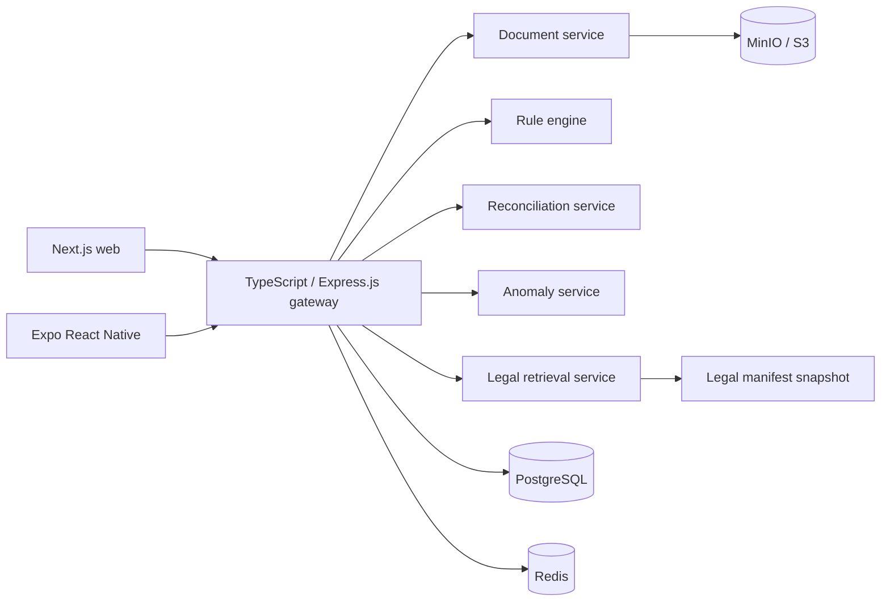

# Kiến trúc AICount Guard

Gateway là trust boundary công khai duy nhất. JWT chứa `tenant_id` và role nhưng gateway
vẫn đọc lại user/role từ database ở mỗi request. Mọi query nghiệp vụ luôn kèm tenant;
object key có tiền tố tenant; các service nội bộ yêu cầu `X-Internal-Key`.

Luồng hóa đơn:

1. Gateway nhận file allowlist và chuyển tới document service.
2. Document service kiểm tra kích thước/nội dung, tính SHA-256, lưu bản gốc bất biến vào MinIO và parse XML/PDF. Ảnh hoặc PDF scan được đánh dấu `needs_ocr`, không sinh dữ liệu đoán.
3. Gateway lưu file, extraction run, extracted fields và invoice lines có version/correlation ID.
4. Rule engine chạy rule-as-data. Ruleset `draft` chỉ chạy khi `RULE_ALLOW_DRAFT=true` và không bao giờ được coi là production-eligible.
5. Reconciliation và anomaly service trả reason code/evidence/version. Risk aggregator dùng đúng trọng số trong README.
6. Mọi sửa field, bỏ qua hoặc quyết định đều tạo review task; chỉ lead/auditor/admin được quyết định.
7. Audit event là append-only về mặt API và nối hash SHA-256 với event trước theo tenant.

Việc tách database vật lý cho từng service là bước scale tiếp theo. Bản hiện tại dùng một
PostgreSQL làm system of record để giữ transaction của workflow, còn compute service là
stateless và có thể scale độc lập.
